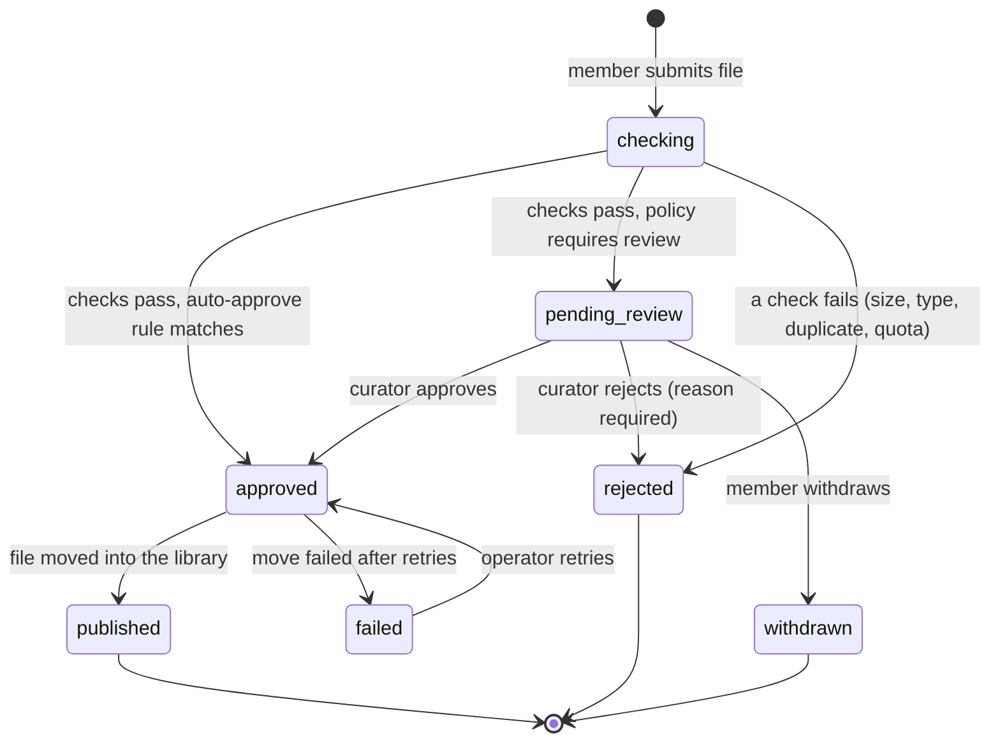
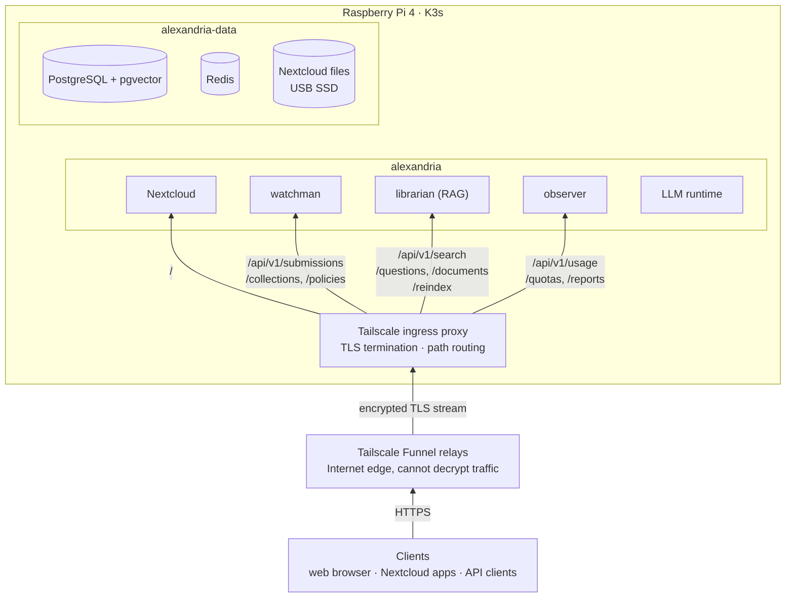
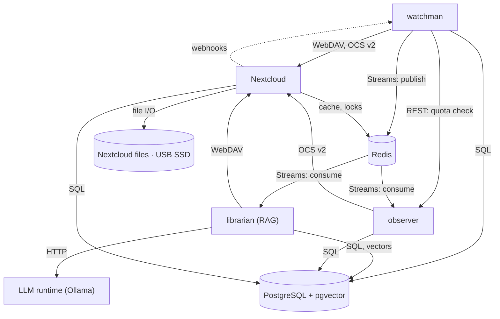
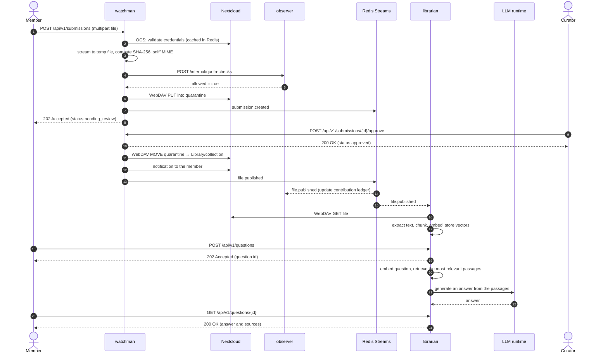

# AlexandrIA - a curated private cloud library

> Cloud-native business layer on top of a self-hosted **Nextcloud**, running on a **Raspberry Pi 4** as an on-premises private cloud (K3s).
>
> Lab project for *Cloud Computing: Fundamentals and Infrastructures* (2026-27). **Current status: Hito 1 - project definition, business model and reference architecture.**

## Table of contents

1. [Domain description](#1-domain-description)
2. [Cloud justification - NIST SP 800-145](#2-cloud-justification---nist-sp-800-145)
3. [Cloud actors - NIST SP 500-292](#3-cloud-actors---nist-sp-500-292)
4. [Architecture](#4-architecture)
5. [REST API specification](#5-rest-api-specification)
6. [Engineering workflow](#6-engineering-workflow)

---

## 1. Domain description

### 1.1 The problem

A household, or a small team, keeps a steady flow of important documents: invoices, contracts, warranties, appliance manuals, medical reports, school paperwork and tax returns. These documents end up spread across phones, laptops, e-mail attachments and commercial cloud drives, which causes four problems:

1. **Data sovereignty.** Documents full of personal data are stored on third-party infrastructure, under someone else's terms.
2. **Disorganised shared folders.** Shared folders fill up with duplicates, files in the wrong place or format and files nobody needs. Since nobody looks after them, nobody relies on them.
3. **Documents are hard to find.** Searching by file name or keyword does not help when you remember neither, for example when you want to know *"when does the washing machine warranty expire?"*.
4. **No visibility of usage.** One member can fill the shared disk, and there is no way to know who uses what or how to split the running costs.

Self-hosting **Nextcloud** solves the first problem, since it provides storage, sync, sharing, user accounts and clients for every platform. It does not solve the other three. Nextcloud is a file sync-and-share platform with no moderation workflow for a shared collection; its built-in search works on names and keywords (its full-text and AI search options depend on extra back-ends that are too heavy for a Raspberry Pi that already runs everything else); and its quotas limit each user's personal space, but not what each member adds to a space owned by another account.

### 1.2 The solution

**AlexandrIA** adds a business layer on top of a self-hosted Nextcloud to manage a shared family library: new files are checked and reviewed before they are published, the documents can be queried in natural language, and usage is measured per member. Nextcloud remains the storage and identity platform, and three microservices implement the business logic through Nextcloud's APIs:

| Service | Responsibility |
|---|---|
| **watchman** | Curation workflow: every contribution to the shared library goes through automatic checks (size, real file type, blocked types, duplicates, quota) and, when the policy requires it, a curator's approval. |
| **librarian** | RAG (retrieval-augmented generation) service: it indexes the library's documents and answers questions about them in natural language. For each question it retrieves the most relevant passages with an embedding model and passes them to a small language model running on the Pi, which writes the answer and cites the documents it used. Documents and answers never leave the household. It also offers plain semantic search, which returns the passages without generating an answer. |
| **observer** | Usage metering: tracks storage, contributions, submissions, searches and questions per member, enforces contribution quotas and produces a monthly report that splits running costs by actual usage. |

**The shared library.** The `Library` folder is owned by a Nextcloud service account and shared read-only with the members' group, so the only way to add a file to it is through watchman. Personal folders are regular Nextcloud storage and are not moderated.

### 1.3 Roles

These roles are used in the use cases and in the user stories of the backlog. They describe who does what in the domain; section 3 maps them to the NIST cloud actors (members and curators are cloud consumers, and the operator is the cloud provider).

| Role | Description |
|---|---|
| **Member** | Household member with a Nextcloud account. Uses personal storage, reads the library, submits files, searches and asks questions. |
| **Curator** | Member of the `curators` Nextcloud group. Reviews submissions and defines moderation policies and quotas. |
| **Operator** | Owner of the Raspberry Pi. Provisions, deploys and monitors the platform. |
| **Developer** | Builds and maintains AlexandrIA's services and repository. |

### 1.4 Main use cases

| ID | Use case | Actor | Service |
|---|---|---|---|
| UC-01 | Submit a file to the shared library | Member | watchman |
| UC-02 | Review (approve / reject) pending submissions | Curator | watchman |
| UC-03 | Track my submissions and get notified of decisions | Member | watchman |
| UC-04 | Configure moderation policies (limits, blocked types, trusted groups) | Curator | watchman |
| UC-05 | Ask a question about the library and get an answer with its sources | Member | librarian |
| UC-06 | Search the library by meaning (semantic search) | Member | librarian |
| UC-07 | Keep the search index in sync with the library | Automatic (event-driven) | librarian |
| UC-08 | Check my storage usage and remaining quota | Member | observer |
| UC-09 | Set contribution quotas and get the monthly cost-split report | Curator | observer |
| UC-10 | Use Nextcloud as usual (personal files, sync clients, sharing) | Member | Nextcloud |

The initial backlog with the user stories, acceptance criteria and technical tasks is in [`docs/backlog/`](docs/backlog) and is published as GitHub Issues labelled `user-story`.

### 1.5 Submission life cycle

Each submission handled by watchman follows this life cycle:



---

## 2. Cloud justification - NIST SP 800-145

**Service model.** For members, AlexandrIA is **SaaS**: they use file storage, curation, search, questions and usage reports through a browser, the Nextcloud apps or the REST API, without managing anything underneath. Internally, the K3s cluster on the Raspberry Pi works as the **PaaS/IaaS** layer that the operator manages.

**Deployment model.** **Private cloud, on-premises**: the infrastructure is provisioned for the exclusive use of a single organisation (the household) with several consumers (its members), and that organisation owns, manages and operates it.

| Essential characteristic | How AlexandrIA uses it | Limitations |
|---|---|---|
| **On-demand self-service** | Members get storage, submit files, search, ask questions, check their quota and create app passwords for API access without any human interaction with the provider. The operator provisions and updates the whole platform declaratively (Terraform + CI/CD), with no manual steps. The curator's approval is one of the library's business rules and has nothing to do with provisioning resources. | Creating a new member account still needs an administrator. |
| **Broad network access** | Everything is reachable over HTTPS from the Internet, through Tailscale Funnel and without opening ports at home, and from the LAN. Many kinds of clients can use it: web browsers, the Nextcloud desktop and mobile apps, the WebDAV clients built into operating systems and scripts using the REST API. | Throughput is limited by the upload bandwidth of the home connection. Funnel is still in beta and applies bandwidth limits that Tailscale does not publish, which can slow down large syncs. |
| **Resource pooling** | All members share one pool of compute, memory and disk. Nextcloud, the three services, the language model and the databases run on the same node; the K3s scheduler places the pods; a single PostgreSQL instance holds a separate database per service; and members use the shared disk without knowing where their files are physically stored. | There is a single physical node, so resources are not pooled across sites or availability zones. |
| **Rapid elasticity** | The three services are stateless Deployments with a HorizontalPodAutoscaler, so their replicas scale out and back in with the load (for example, when many searches arrive at once, since computing embeddings is CPU-bound). Work that cannot run in parallel on the Pi is queued: new uploads are indexed asynchronously through an event stream, and questions wait in a queue and are answered one at a time, so a burst of requests makes answers take longer but does not overload the node. Storage can grow by expanding volumes or adding disks. | Elasticity is limited by one Raspberry Pi: 4 cores and 8 GB of RAM shared by Nextcloud, the databases, K3s, the services and the language model. Generating an answer uses most of the CPU, so only one question is answered at a time. Scaling beyond the Pi means adding more Pis as K3s agent nodes, which is not instantaneous. |
| **Measured service** | observer records, per member and per month, personal storage, bytes contributed to the library, submissions, searches and questions. It enforces contribution quotas, shows each member their own usage (`GET /usage/me`) and produces a report that splits the running cost of the NAS according to usage (showback). Kubernetes metrics (CPU and RAM per pod) feed the autoscaler. | The cost split is informative (showback); nobody is actually charged. |

---

## 3. Cloud actors - NIST SP 500-292

| Actor | Who in AlexandrIA | Responsibilities |
|---|---|---|
| **Cloud Consumer** | The household members and curators (SaaS consumers). | Use storage, curation, search, questions and usage reports, and accept the household's usage policy (quotas and moderation rules). |
| **Cloud Provider** | Me, the student, as operator and owner of the Raspberry Pi. | I deploy the private cloud, orchestrate it (K3s on the Pi), manage it (provisioning with Terraform, CI/CD, monitoring) and take care of security and privacy (GDPR, least privilege, backups). |
| **Cloud Broker** | The organisation that develops AlexandrIA. It acts as a **service intermediation** broker: it does not provide the storage service itself, which comes from Nextcloud, but builds on it the capabilities Nextcloud lacks (curation, RAG and usage metering) and exposes them through a single API. | Manage how consumers use the underlying storage service and add value to it. |
| **Cloud Auditor** | Covered only in part. The course instructor evaluates each milestone, and the CI/CD pipeline automatically checks every change (linters, tests, image builds) and looks for infrastructure drift (`terraform plan -detailed-exitcode`) before each deployment. | Check that the project meets the course requirements and that the running infrastructure matches its declared state. A formal cloud auditor would also carry out independent security and privacy assessments, verify performance against an SLA and check compliance with standards such as ISO/IEC 27001, which this project does not do. |
| **Cloud Carrier** | My home Internet provider and Tailscale, whose Funnel relays carry the encrypted traffic between the Internet and the Pi; on the client side, the members' home and mobile providers. | Connectivity and transport between consumers and provider. |

In this project I take on several of these roles at the same time: provider and, as the developer of AlexandrIA, broker.

### 3.1 Economic impact

The private cloud replaces a recurring operating expense (a commercial cloud storage subscription) with a small capital expense and very low operating costs.

> Figures are approximate market prices and typical consumption values (October 2026).

| Item | Type | Approx. cost |
|---|---|---|
| Raspberry Pi 4 Model B (8 GB) + power supply + case | CAPEX (already owned) | ≈ €100 |
| 1 TB USB SSD | CAPEX (already owned) | ≈ €70 |
| Electricity: ≈ 5 W average (Pi 4 + SSD, mostly idle) × 8,760 h ≈ 44 kWh/year at ≈ €0.19/kWh (regulated tariff, taxes included) | OPEX | ≈ €8/year |
| Internet connection | OPEX (already paid for other uses, so the marginal cost is €0) | €0 |
| Tailscale, container registry, CI minutes (free plans, public repository) | OPEX | €0 |

With the hardware amortised over 3 years, the platform costs about **€65 a year (about €5.40 a month) for the whole household**. A commercial family plan with around 2 TB of storage typically costs around €100 a year, and more if extra space is needed. The private cloud pays for itself in about two years, and since the hardware is already owned, the extra cost of running it is mostly electricity.

**Impact on each actor:**

- Consumers do not pay per use. observer splits the fixed monthly cost according to the storage each member uses, so members who store more pay a larger share, as they would with the pay-per-use model of a public cloud.
- As the provider, I pay for the hardware up front and take the risk of a failure (replacement cost and possible data loss, so backups are a priority). The time spent running the platform is not included in the figures above, and it is the main cost of self-hosting.
- The broker's services run on the same hardware, so they add no infrastructure cost.
- The carriers cost nothing extra (the home connection is already paid for and Funnel is free), but they offer no SLA: an outage or the limited upload bandwidth directly affects availability and performance.
- Automated auditing uses free CI minutes for public repositories.

Overall, the household gains control over its data and low running costs in exchange for having no SLA: availability depends on the home power supply and Internet connection, and durability depends on keeping backups.

---

## 4. Architecture

### 4.1 Overview

The architecture is shown in two diagrams: the first one shows how requests reach the platform and where each component runs, and the second one shows how the components communicate.

**Deployment and request routing.** Everything inside the outer box runs on the Raspberry Pi, at home in Spain (EU). The inner boxes are the two Kubernetes namespaces: `alexandria` for the applications and `alexandria-data` for the stateful components.



**Communication between components.** Each arrow starts at the component that opens the communication and shows the protocol it uses. Section 4.3 describes each interaction.



### 4.2 Components

| Component | Technology | Responsibility | State |
|---|---|---|---|
| Nextcloud | Official `nextcloud` image (arm64), version ≥ 30 for the `webhook_listeners` app | File storage, sync, sharing, identity (users, groups, app passwords), notifications, file-event webhooks, web UI | Files on the SSD volume; metadata in PostgreSQL |
| watchman | Python, FastAPI | Submission workflow, automatic checks, moderation policies, curator decisions; single entry point for Nextcloud file-event webhooks, which it republishes as domain events | `watchman` DB (submissions, history, policies) |
| librarian | Python, FastAPI, [fastembed](https://github.com/qdrant/fastembed) (ONNX Runtime) with `paraphrase-multilingual-MiniLM-L12-v2` (384 dimensions, multilingual because household documents are mostly in Spanish) | RAG: text extraction, chunking, embeddings, retrieval, answer generation through the LLM runtime (one question at a time, from a queue), semantic search, index maintenance | `librarian` DB (documents, chunks, vectors via pgvector, questions and answers) |
| LLM runtime | [Ollama](https://ollama.com) (arm64) with a small multilingual instruct model (about 0.5-1.5B parameters, quantised, for example Qwen2.5 1.5B Instruct) | Generates answers from the passages retrieved by librarian; only reachable from librarian | Model files on the SSD volume |
| observer | Python, FastAPI | Usage ledger, quotas, monthly cost-split reports | `observer` DB (usage events, aggregates, quotas) |
| PostgreSQL + pgvector | `pgvector/pgvector` image (pinned tag, e.g. `pg17`) | Relational persistence and vector similarity search; one database and one role per service | Volume on the SSD |
| Redis | Official image | Nextcloud cache and file locking; event stream between services; question queue; short-lived auth cache | In memory (with persistence for the stream) |
| Tailscale operator and ingress proxy | Tailscale Kubernetes operator (replaces the Traefik ingress that K3s installs by default) | Public HTTPS entry point through Funnel, TLS termination inside the cluster and path routing to Nextcloud or to each service; `/internal/*` is never exposed | — |

**Nextcloud accounts used by the services.** Services act on Nextcloud through a dedicated service account that owns the `Library` and quarantine folders. Sending notifications and registering webhooks require Nextcloud admin rights, so this account is an admin and its app password is stored as a Kubernetes Secret. observer only reads other members' storage usage, so it uses a separate account that is a *group sub-admin* of the members' group (least privilege).

**Common service stack:** Python 3.13, FastAPI, Pydantic v2, SQLAlchemy 2 (async) + Alembic, httpx (Nextcloud client), redis-py (Streams), pytest, ruff, uv. All components run on `linux/arm64` (the Raspberry Pi).

### 4.3 Communication

| From → To | Protocol | Style | Purpose |
|---|---|---|---|
| Clients → platform | HTTPS through Tailscale Funnel (TLS is terminated by the ingress proxy inside the cluster; the Funnel relays cannot decrypt the traffic) | Sync | Web UI, Nextcloud clients (WebDAV), REST API |
| watchman → Nextcloud | WebDAV over HTTP | Sync | Upload to quarantine, `MOVE` into the library (no request body, so the file is not uploaded again), `DELETE` |
| services → Nextcloud | OCS API v2 (`/ocs/v2.php/...`, JSON) | Sync | Validate credentials and read groups (`/cloud/user`), send notifications (`/apps/notifications/api/v2/admin_notifications/{user}`), read storage usage (`/cloud/users/{user}`) |
| Nextcloud → watchman | HTTP webhooks (`webhook_listeners` app, shared-secret header) | Async (delivered by Nextcloud background jobs) | Files renamed or deleted directly in Nextcloud (for example, a curator tidying the library from the web UI) |
| watchman → observer | REST/JSON (internal endpoint) | Sync, with timeout and fail-safe | Quota check before accepting a submission |
| librarian → LLM runtime | HTTP/JSON (Ollama API) | Sync, from a single background worker | Generate an answer from the retrieved passages |
| watchman → librarian, observer | Redis Streams (consumer groups, at-least-once) | Async | Domain events: `submission.created`, `submission.decided`, `file.published`, `file.renamed`, `file.removed` |
| librarian → observer | Redis Streams | Async | `search.performed` and `question.answered` usage events |
| services → PostgreSQL | PostgreSQL wire protocol | Sync | Each service owns its database; no service reads another's tables |

Nextcloud delivers webhooks from background jobs (every ~5 minutes with cron, or in near real time with a dedicated background-job worker). The main flow does not depend on them: publications are events emitted by watchman itself.

**Event envelope** (one stream, `alexandria.events`):

```json
{
  "id": "01JB8Z6M3Q7W2V5N9K4T0XR1HC",
  "type": "file.published",
  "occurred_at": "2026-10-19T17:45:02Z",
  "actor": "carol",
  "data": {
    "submission_id": "sub_01JB8Z5Y0F",
    "path": "Library/Manuals/washing-machine-warranty.pdf",
    "file_id": 4182,
    "size_bytes": 482133,
    "sha256": "9f2c1e...",
    "submitted_by": "alice"
  }
}
```

### 4.4 Main flow: from submission to answer



### 4.5 Deployment: a private cloud on a Raspberry Pi

The platform runs on a **Raspberry Pi 4 Model B (8 GB)** with a **USB SSD** for all persistent data, using **K3s** (a lightweight, certified Kubernetes distribution) as the cloud layer. K3s is installed without its default Traefik ingress, because the Tailscale Kubernetes operator provides the ingress; its built-in NetworkPolicy controller and metrics-server are kept.

| Concern | Implementation |
|---|---|
| Network isolation | Two namespaces: `alexandria` (Nextcloud, the services and the LLM runtime) and `alexandria-data` (PostgreSQL, Redis) |
| Traffic rules (least privilege) | NetworkPolicies: default deny, explicit allows (ingress proxy → public routes; services → Nextcloud; Nextcloud → watchman webhooks; services → data tier; only watchman → observer's internal endpoint; only librarian → LLM runtime) |
| Public entry point | Tailscale Ingress exposed with Funnel on port 443 at `https://<name>.<tailnet>.ts.net`: no ports are opened on the home router, and TLS is terminated inside the cluster |
| Compute | Deployments (Nextcloud, watchman, librarian, observer, LLM runtime); the stateless services scale with a HorizontalPodAutoscaler |
| Storage | PersistentVolumeClaims backed by the USB SSD |
| Data residency | All data stays on hardware located in Spain (EU) and controlled by the household |

---

## 5. REST API specification

### 5.1 Conventions

- **Base URL:** `https://<host>/api/v1`, where `<host>` is the Funnel hostname (`<name>.<tailnet>.ts.net`). The ingress routes each resource to its service (and every other path to Nextcloud); `/internal/*` is never exposed publicly.
- **Format:** JSON (`application/json`), except file uploads (`multipart/form-data`). Timestamps in ISO 8601 UTC; sizes in bytes; ids are prefixed ULIDs (`sub_...`, `doc_...`, `q_...`).
- **Authentication:** HTTP Basic with the member's Nextcloud username and an **app password** (members create them in their Nextcloud security settings and can revoke them at any time). Services validate credentials with `GET /ocs/v2.php/cloud/user` (which returns `401` for invalid credentials and includes the user's `groups`) and cache the result in Redis for a few minutes. Members of the `curators` group get curator permissions. Internal endpoints use a per-service token stored in a Kubernetes Secret. Nextcloud's built-in OAuth2 provider was discarded because its tokens have no scopes (full account access).
- **Errors:** [RFC 9457](https://www.rfc-editor.org/rfc/rfc9457) problem details (`application/problem+json`):

  ```json
  { "type": "https://<host>/problems/duplicate-file", "title": "Duplicate file", "status": 422,
    "detail": "An identical file already exists in the library.", "instance": "/api/v1/submissions",
    "submission_id": "sub_01JB8Z5Y0F", "existing_path": "Library/Manuals/washing-machine-warranty.pdf" }
  ```

- **Pagination:** `limit` (default 20, max 100) and `offset`; list responses are `{ "items": [...], "total": n, "limit": l, "offset": o }`.
- **Common status codes:** `401` invalid credentials, `403` insufficient role, `404` not found, `409` invalid state transition, `422` validation or failed check.

### 5.2 watchman - curation workflow

| Method | Route | Role | Description |
|---|---|---|---|
| `POST` | `/submissions` | member | Submit a file (`multipart/form-data`: `file`, `collection`, `note`). `202` with the submission; `422` if a check fails |
| `GET` | `/submissions` | member / curator | List submissions. Members see their own; curators see all. Filters: `status`, `submitted_by` |
| `GET` | `/submissions/{id}` | owner / curator | Submission detail with check results and status history |
| `DELETE` | `/submissions/{id}` | owner | Withdraw a submission that is still `pending_review` (`204`, or `409` if already decided) |
| `POST` | `/submissions/{id}/approve` | curator | Approve; the file is moved into the library asynchronously |
| `POST` | `/submissions/{id}/reject` | curator | Reject with a mandatory reason; the quarantined file is deleted |
| `GET` | `/collections` | member | Library collections (top-level folders) that accept submissions |
| `GET` | `/policies` | curator | Current moderation policy |
| `PUT` | `/policies` | curator | Replace the policy (validated and versioned) |
| `POST` | `/internal/webhooks/nextcloud` | Nextcloud (shared secret) | File-event webhook (`NodeRenamedEvent`, `NodeDeletedEvent` in the library), republished as `file.renamed` / `file.removed`. Not exposed through the ingress |

`POST /submissions` → `202 Accepted`

```json
{
  "id": "sub_01JB8Z5Y0F",
  "status": "pending_review",
  "filename": "washing-machine-warranty.pdf",
  "collection": "Manuals",
  "size_bytes": 482133,
  "mime_type": "application/pdf",
  "sha256": "9f2c1e...",
  "submitted_by": "alice",
  "note": "Warranty for the new washing machine",
  "checks": [
    { "name": "size_limit", "result": "pass" },
    { "name": "mime_consistency", "result": "pass" },
    { "name": "blocked_type", "result": "pass" },
    { "name": "duplicate", "result": "pass" },
    { "name": "quota", "result": "pass", "detail": "1.2 GB of 5 GB used" }
  ],
  "created_at": "2026-10-19T17:42:10Z"
}
```

`POST /submissions/{id}/reject` - request:

```json
{ "reason": "Scanned upside down, please rescan." }
```

`PUT /policies` - request:

```json
{
  "max_size_bytes": 52428800,
  "allowed_mime_types": ["application/pdf", "text/*", "image/jpeg", "image/png",
                         "application/vnd.openxmlformats-officedocument.wordprocessingml.document"],
  "blocked_extensions": [".exe", ".msi", ".bat", ".sh", ".apk"],
  "auto_approve": { "groups": ["trusted"], "max_size_bytes": 10485760 }
}
```

### 5.3 librarian - RAG and semantic search

| Method | Route | Role | Description |
|---|---|---|---|
| `POST` | `/questions` | member | Ask a question about the library (`question`, optional `collection`). `202` with the question id; questions are queued and answered one at a time |
| `GET` | `/questions/{id}` | owner | Question status (`queued`, `answering`, `answered`, `failed`) and, once answered, the answer with its sources |
| `GET` | `/search` | member | Semantic search, without generating an answer. Query: `q` (required, 3-500 chars), `k` (1-20, default 5), `collection` |
| `GET` | `/documents` | curator | Indexed documents. Filter `status`: `indexed`, `pending`, `failed`, `skipped` |
| `GET` | `/documents/{id}` | member | Document metadata (path, collection, chunks, indexed at) |
| `POST` | `/reindex` | curator | Start a full or per-collection re-index job (`202` with job id) |
| `GET` | `/reindex/{job_id}` | curator | Re-index job progress |

`POST /questions` - request `{ "question": "When does the washing machine warranty expire?", "collection": "Manuals" }` → `202 Accepted` `{ "id": "q_01JB9C4N2M", "status": "queued" }`

`GET /questions/q_01JB9C4N2M` → `200 OK`

```json
{
  "id": "q_01JB9C4N2M",
  "status": "answered",
  "question": "When does the washing machine warranty expire?",
  "answer": "The warranty lasts three years from the date of purchase (12 March 2026), so it expires on 12 March 2029.",
  "sources": [
    {
      "document_id": "doc_01JB9A0C2D",
      "path": "Library/Manuals/washing-machine-warranty.pdf",
      "snippet": "...the warranty period is three (3) years from the date of purchase...",
      "url": "https://<host>/f/4182"
    },
    {
      "document_id": "doc_01JB9A7Q5R",
      "path": "Library/Invoices/2026-03-12-washing-machine.pdf",
      "snippet": "...Invoice date: 12/03/2026...",
      "url": "https://<host>/f/4190"
    }
  ],
  "model": "qwen2.5:1.5b",
  "asked_at": "2026-10-19T18:02:11Z",
  "answered_at": "2026-10-19T18:03:05Z"
}
```

`GET /search?q=when does the washing machine warranty expire&k=3` → `200 OK`

```json
{
  "query": "when does the washing machine warranty expire",
  "took_ms": 84,
  "results": [
    {
      "document_id": "doc_01JB9A0C2D",
      "path": "Library/Manuals/washing-machine-warranty.pdf",
      "collection": "Manuals",
      "snippet": "...the warranty period is three (3) years from the date of purchase...",
      "score": 0.82,
      "url": "https://<host>/f/4182"
    }
  ]
}
```

`POST /reindex` - request `{ "collection": "Manuals" }` → `202 Accepted` `{ "job_id": "job_01JB9B7K", "status": "queued" }`

### 5.4 observer - usage, quotas and reports

| Method | Route | Role | Description |
|---|---|---|---|
| `GET` | `/usage/me` | member | My personal storage, library contributions, submissions, searches and questions this month, remaining quota |
| `GET` | `/usage` | curator | Usage of every member. Query: `period=YYYY-MM` |
| `GET` | `/quotas/{user}` | self / curator | Contribution quota of a member |
| `PUT` | `/quotas/{user}` | curator | Set a member's contribution quota |
| `GET` | `/reports/{period}` | curator | Monthly cost-split report (`period=YYYY-MM`) |
| `POST` | `/internal/quota-checks` | watchman (service token) | Can this member contribute `size_bytes` more? Not exposed through the ingress |

`GET /usage/me` → `200 OK`

```json
{
  "user": "alice",
  "period": "2026-10",
  "personal_storage": { "used_bytes": 8321499136, "quota_bytes": 107374182400 },
  "library_contribution": { "used_bytes": 1288490188, "quota_bytes": 5368709120 },
  "submissions": { "this_period": 14, "limit": 50 },
  "searches": { "this_period": 230 },
  "questions": { "this_period": 12 }
}
```

`PUT /quotas/alice` - request:

```json
{ "max_contribution_bytes": 5368709120, "max_submissions_per_month": 50 }
```

`POST /internal/quota-checks` - request `{ "user": "alice", "size_bytes": 482133 }` → `200 OK`

```json
{ "allowed": true, "remaining_bytes": 4079736799, "remaining_submissions": 35 }
```

`GET /reports/2026-10` → `200 OK`

```json
{
  "period": "2026-10",
  "monthly_cost_eur": 5.40,
  "split_rule": "proportional_to_storage",
  "members": [
    { "user": "alice", "storage_bytes": 9609989324, "share": 0.46, "amount_eur": 2.48, "submissions": 14, "searches": 230, "questions": 12 },
    { "user": "bob",   "storage_bytes": 11281069056, "share": 0.54, "amount_eur": 2.92, "submissions": 3,  "searches": 41, "questions": 5 }
  ]
}
```

---

## 6. Engineering workflow

- **Branching:** trunk-based with short-lived feature branches (`feat/...`, `fix/...`, `docs/...`), squash-merged into a protected `main` through pull requests. Details in [CONTRIBUTING.md](CONTRIBUTING.md).
- **Commits:** [Conventional Commits](https://www.conventionalcommits.org/) (`feat:`, `fix:`, `docs:`, `refactor:`, `test:`, `chore:`), with service scopes (`feat(watchman): ...`).
- **User stories:** GitHub Issues created from the [user story template](.github/ISSUE_TEMPLATE/user_story.md), labelled `user-story`, with acceptance criteria and a task checklist, and assigned to a milestone per Hito. The initial backlog is in [`docs/backlog/`](docs/backlog).
- **Pull requests:** [PR template](.github/PULL_REQUEST_TEMPLATE.md) linking the user story it closes.
