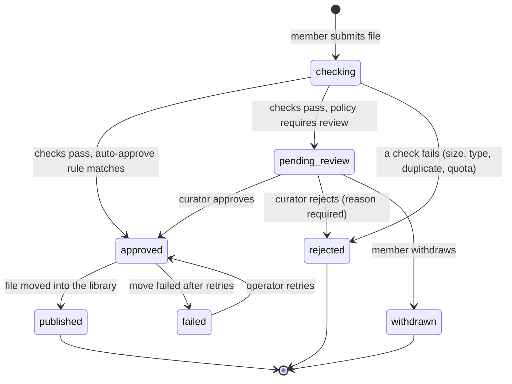
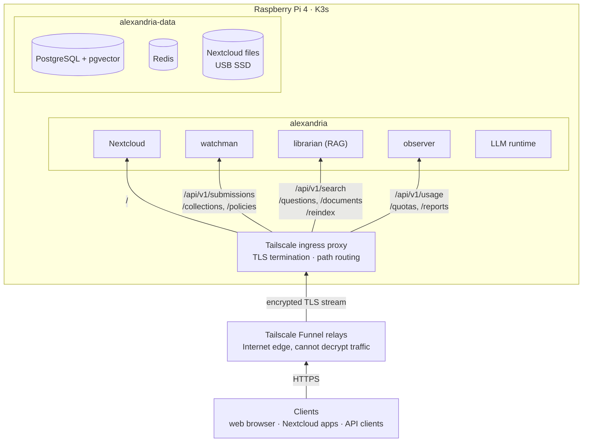
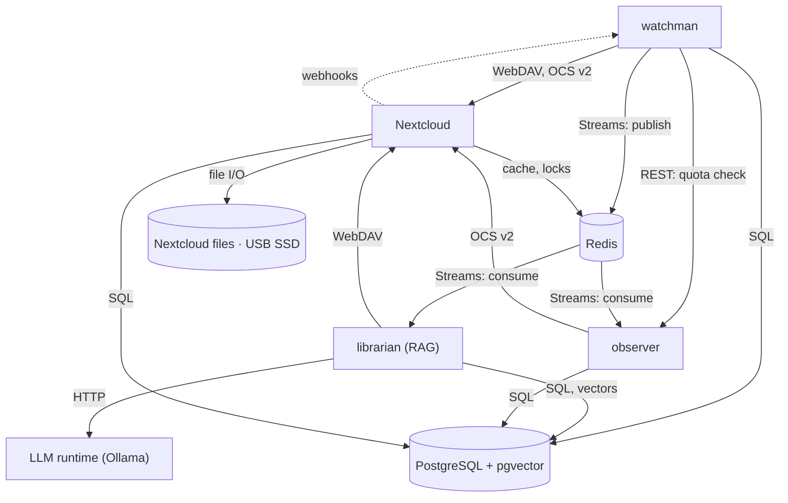
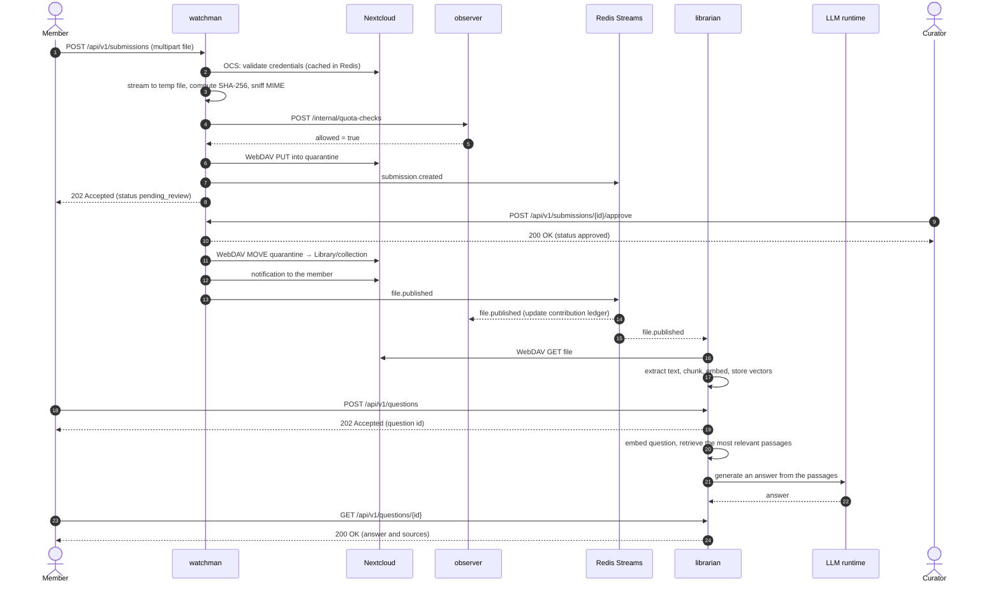

# AlexandrIA - a curated private cloud library

[](https://github.com/feglez/AlexandrIA/actions/workflows/ci.yml)

> Cloud-native business layer on top of a self-hosted **Nextcloud**, running on a **Raspberry Pi 4** as an on-premises private cloud (K3s).
>
> Lab project for *Cloud Computing: Fundamentals and Infrastructures* (2026-27). **Current status: Hito 1 - project definition, business model and reference architecture.**

## Table of contents

1. [Domain description](#1-domain-description)
2. [Cloud justification - NIST SP 800-145](#2-cloud-justification---nist-sp-800-145)
3. [Cloud actors - NIST SP 500-292](#3-cloud-actors---nist-sp-500-292)
4. [Architecture](#4-architecture)
5. [REST API specification](#5-rest-api-specification)
6. [Engineering workflow](#6-engineering-workflow)
7. [Local environment](#7-local-environment)
8. [Container images](#8-container-images)
9. [Continuous integration](#9-continuous-integration)

---

## 1. Domain description

### 1.1 The problem

A household, or a small team, keeps a steady flow of important documents: invoices, contracts, warranties, appliance manuals, medical reports, school paperwork and tax returns. These documents end up spread across phones, laptops, e-mail attachments and commercial cloud drives, which causes four problems:

1. **Data sovereignty.** Documents full of personal data are stored on third-party infrastructure, under someone else's terms.
2. **Disorganised shared folders.** Shared folders fill up with duplicates, files in the wrong place or format and files nobody needs. Since nobody looks after them, nobody relies on them.
3. **Documents are hard to find.** Searching by file name or keyword does not help when you remember neither, for example when you want to know *"when does the washing machine warranty expire?"*.
4. **No visibility of usage.** One member can fill the shared disk, and there is no way to know who uses what or how to split the running costs.

Self-hosting **Nextcloud** solves the first problem, since it provides storage, sync, sharing, user accounts and clients for every platform. It does not solve the other three. Nextcloud is a file sync-and-share platform with no moderation workflow for a shared collection; its built-in search works on names and keywords (its full-text and AI search options depend on extra back-ends that are too heavy for a Raspberry Pi that already runs everything else); and its quotas limit each user's personal space, but not what each member adds to a space owned by another account.

### 1.2 The solution

**AlexandrIA** adds a business layer on top of a self-hosted Nextcloud to manage a shared family library: new files are checked and reviewed before they are published, the documents can be queried in natural language, and usage is measured per member. Nextcloud remains the storage and identity platform, and three microservices implement the business logic through Nextcloud's APIs:

| Service | Responsibility |
|---|---|
| **watchman** | Curation workflow: every contribution to the shared library goes through automatic checks (size, real file type, blocked types, duplicates, quota) and, when the policy requires it, a curator's approval. |
| **librarian** | RAG (retrieval-augmented generation) service: it indexes the library's documents and answers questions about them in natural language. For each question it retrieves the most relevant passages with an embedding model and passes them to a small language model running on the Pi, which writes the answer and cites the documents it used. Documents and answers never leave the household. It also offers plain semantic search, which returns the passages without generating an answer. |
| **observer** | Usage metering: tracks storage, contributions, submissions, searches and questions per member, enforces contribution quotas and produces a monthly report that splits running costs by actual usage. |

**The shared library.** The `Library` folder is owned by a Nextcloud service account and shared read-only with the members' group, so the only way to add a file to it is through watchman. Personal folders are regular Nextcloud storage and are not moderated.

### 1.3 Roles

These roles are used in the use cases and in the user stories of the backlog. They describe who does what in the domain; section 3 maps them to the NIST cloud actors (members and curators are cloud consumers, and the operator is the cloud provider).

| Role | Description |
|---|---|
| **Member** | Household member with a Nextcloud account. Uses personal storage, reads the library, submits files, searches and asks questions. |
| **Curator** | Member of the `curators` Nextcloud group. Reviews submissions and defines moderation policies and quotas. |
| **Operator** | Owner of the Raspberry Pi. Provisions, deploys and monitors the platform. |
| **Developer** | Builds and maintains AlexandrIA's services and repository. |

### 1.4 Main use cases

| ID | Use case | Actor | Service |
|---|---|---|---|
| UC-01 | Submit a file to the shared library | Member | watchman |
| UC-02 | Review (approve / reject) pending submissions | Curator | watchman |
| UC-03 | Track my submissions and get notified of decisions | Member | watchman |
| UC-04 | Configure moderation policies (limits, blocked types, trusted groups) | Curator | watchman |
| UC-05 | Ask a question about the library and get an answer with its sources | Member | librarian |
| UC-06 | Search the library by meaning (semantic search) | Member | librarian |
| UC-07 | Keep the search index in sync with the library | Automatic (event-driven) | librarian |
| UC-08 | Check my storage usage and remaining quota | Member | observer |
| UC-09 | Set contribution quotas and get the monthly cost-split report | Curator | observer |
| UC-10 | Use Nextcloud as usual (personal files, sync clients, sharing) | Member | Nextcloud |

The initial backlog with the user stories, acceptance criteria and technical tasks is in [`docs/backlog/`](docs/backlog) and is published as GitHub Issues labelled `user-story`.

### 1.5 Submission life cycle

Each submission handled by watchman follows this life cycle:



---

## 2. Cloud justification - NIST SP 800-145

**Service model.** For members, AlexandrIA is **SaaS**: they use file storage, curation, search, questions and usage reports through a browser, the Nextcloud apps or the REST API, without managing anything underneath. Internally, the K3s cluster on the Raspberry Pi works as the **PaaS/IaaS** layer that the operator manages.

**Deployment model.** **Private cloud, on-premises**: the infrastructure is provisioned for the exclusive use of a single organisation (the household) with several consumers (its members), and that organisation owns, manages and operates it.

| Essential characteristic | How AlexandrIA uses it | Limitations |
|---|---|---|
| **On-demand self-service** | Members get storage, submit files, search, ask questions, check their quota and create app passwords for API access without any human interaction with the provider. The operator provisions and updates the whole platform declaratively (Terraform + CI/CD), with no manual steps. The curator's approval is one of the library's business rules and has nothing to do with provisioning resources. | Creating a new member account still needs an administrator. |
| **Broad network access** | Everything is reachable over HTTPS from the Internet, through Tailscale Funnel and without opening ports at home, and from the LAN. Many kinds of clients can use it: web browsers, the Nextcloud desktop and mobile apps, the WebDAV clients built into operating systems and scripts using the REST API. | Throughput is limited by the upload bandwidth of the home connection. Funnel is still in beta and applies bandwidth limits that Tailscale does not publish, which can slow down large syncs. |
| **Resource pooling** | All members share one pool of compute, memory and disk. Nextcloud, the three services, the language model and the databases run on the same node; the K3s scheduler places the pods; a single PostgreSQL instance holds a separate database per service; and members use the shared disk without knowing where their files are physically stored. | There is a single physical node, so resources are not pooled across sites or availability zones. |
| **Rapid elasticity** | The three services are stateless Deployments with a HorizontalPodAutoscaler, so their replicas scale out and back in with the load (for example, when many searches arrive at once, since computing embeddings is CPU-bound). Work that cannot run in parallel on the Pi is queued: new uploads are indexed asynchronously through an event stream, and questions wait in a queue and are answered one at a time, so a burst of requests makes answers take longer but does not overload the node. Storage can grow by expanding volumes or adding disks. | Elasticity is limited by one Raspberry Pi: 4 cores and 8 GB of RAM shared by Nextcloud, the databases, K3s, the services and the language model. Generating an answer uses most of the CPU, so only one question is answered at a time. Scaling beyond the Pi means adding more Pis as K3s agent nodes, which is not instantaneous. |
| **Measured service** | observer records, per member and per month, personal storage, bytes contributed to the library, submissions, searches and questions. It enforces contribution quotas, shows each member their own usage (`GET /usage/me`) and produces a report that splits the running cost of the NAS according to usage (showback). Kubernetes metrics (CPU and RAM per pod) feed the autoscaler. | The cost split is informative (showback); nobody is actually charged. |

---

## 3. Cloud actors - NIST SP 500-292

| Actor | Who in AlexandrIA | Responsibilities |
|---|---|---|
| **Cloud Consumer** | The household members and curators (SaaS consumers). | Use storage, curation, search, questions and usage reports, and accept the household's usage policy (quotas and moderation rules). |
| **Cloud Provider** | Me, the student, as operator and owner of the Raspberry Pi. | I deploy the private cloud, orchestrate it (K3s on the Pi), manage it (provisioning with Terraform, CI/CD, monitoring) and take care of security and privacy (GDPR, least privilege, backups). |
| **Cloud Broker** | The organisation that develops AlexandrIA. It acts as a **service intermediation** broker: it does not provide the storage service itself, which comes from Nextcloud, but builds on it the capabilities Nextcloud lacks (curation, RAG and usage metering) and exposes them through a single API. | Manage how consumers use the underlying storage service and add value to it. |
| **Cloud Auditor** | Covered only in part. The course instructor evaluates each milestone, and the CI/CD pipeline automatically checks every change (linters, tests, image builds) and looks for infrastructure drift (`terraform plan -detailed-exitcode`) before each deployment. | Check that the project meets the course requirements and that the running infrastructure matches its declared state. A formal cloud auditor would also carry out independent security and privacy assessments, verify performance against an SLA and check compliance with standards such as ISO/IEC 27001, which this project does not do. |
| **Cloud Carrier** | My home Internet provider and Tailscale, whose Funnel relays carry the encrypted traffic between the Internet and the Pi; on the client side, the members' home and mobile providers. | Connectivity and transport between consumers and provider. |

In this project I take on several of these roles at the same time: provider and, as the developer of AlexandrIA, broker.

### 3.1 Economic impact

The private cloud replaces a recurring operating expense (a commercial cloud storage subscription) with a small capital expense and very low operating costs.

> Figures are approximate market prices and typical consumption values (October 2026).

| Item | Type | Approx. cost |
|---|---|---|
| Raspberry Pi 4 Model B (8 GB) + power supply + case | CAPEX (already owned) | ≈ €100 |
| 1 TB USB SSD | CAPEX (already owned) | ≈ €70 |
| Electricity: ≈ 5 W average (Pi 4 + SSD, mostly idle) × 8,760 h ≈ 44 kWh/year at ≈ €0.19/kWh (regulated tariff, taxes included) | OPEX | ≈ €8/year |
| Internet connection | OPEX (already paid for other uses, so the marginal cost is €0) | €0 |
| Tailscale, container registry, CI minutes (free plans, public repository) | OPEX | €0 |

With the hardware amortised over 3 years, the platform costs about **€65 a year (about €5.40 a month) for the whole household**. A commercial family plan with around 2 TB of storage typically costs around €100 a year, and more if extra space is needed. The private cloud pays for itself in about two years, and since the hardware is already owned, the extra cost of running it is mostly electricity.

**Impact on each actor:**

- Consumers do not pay per use. observer splits the fixed monthly cost according to the storage each member uses, so members who store more pay a larger share, as they would with the pay-per-use model of a public cloud.
- As the provider, I pay for the hardware up front and take the risk of a failure (replacement cost and possible data loss, so backups are a priority). The time spent running the platform is not included in the figures above, and it is the main cost of self-hosting.
- The broker's services run on the same hardware, so they add no infrastructure cost.
- The carriers cost nothing extra (the home connection is already paid for and Funnel is free), but they offer no SLA: an outage or the limited upload bandwidth directly affects availability and performance.
- Automated auditing uses free CI minutes for public repositories.

Overall, the household gains control over its data and low running costs in exchange for having no SLA: availability depends on the home power supply and Internet connection, and durability depends on keeping backups.

---

## 4. Architecture

### 4.1 Overview

The architecture is shown in two diagrams: the first one shows how requests reach the platform and where each component runs, and the second one shows how the components communicate.

**Deployment and request routing.** Everything inside the outer box runs on the Raspberry Pi, at home in Spain (EU). The inner boxes are the two Kubernetes namespaces: `alexandria` for the applications and `alexandria-data` for the stateful components.



**Communication between components.** Each arrow starts at the component that opens the communication and shows the protocol it uses. Section 4.3 describes each interaction.



### 4.2 Components

| Component | Technology | Responsibility | State |
|---|---|---|---|
| Nextcloud | Official `nextcloud` image (arm64), version ≥ 30 for the `webhook_listeners` app | File storage, sync, sharing, identity (users, groups, app passwords), notifications, file-event webhooks, web UI | Files on the SSD volume; metadata in PostgreSQL |
| watchman | Python, FastAPI | Submission workflow, automatic checks, moderation policies, curator decisions; single entry point for Nextcloud file-event webhooks, which it republishes as domain events | `watchman` DB (submissions, history, policies) |
| librarian | Python, FastAPI, [fastembed](https://github.com/qdrant/fastembed) (ONNX Runtime) with `paraphrase-multilingual-MiniLM-L12-v2` (384 dimensions, multilingual because household documents are mostly in Spanish) | RAG: text extraction, chunking, embeddings, retrieval, answer generation through the LLM runtime (one question at a time, from a queue), semantic search, index maintenance | `librarian` DB (documents, chunks, vectors via pgvector, questions and answers) |
| LLM runtime | [Ollama](https://ollama.com) (arm64) with a small multilingual instruct model (about 0.5-1.5B parameters, quantised, for example Qwen2.5 1.5B Instruct) | Generates answers from the passages retrieved by librarian; only reachable from librarian | Model files on the SSD volume |
| observer | Python, FastAPI | Usage ledger, quotas, monthly cost-split reports | `observer` DB (usage events, aggregates, quotas, storage snapshots) |
| PostgreSQL + pgvector | `pgvector/pgvector` image (pinned tag, e.g. `pg17`) | Relational persistence and vector similarity search; one database and one role per service | Volume on the SSD |
| Redis | Official image | Nextcloud cache and file locking; event stream between services; question queue; short-lived auth cache | In memory (with persistence for the stream) |
| Tailscale operator and ingress proxy | Tailscale Kubernetes operator (replaces the Traefik ingress that K3s installs by default) | Public HTTPS entry point through Funnel, TLS termination inside the cluster and path routing to Nextcloud or to each service; `/internal/*` is never exposed | — |

**Nextcloud accounts used by the services.** Services act on Nextcloud through a dedicated service account that owns the `Library` and quarantine folders. Sending notifications and registering webhooks require Nextcloud admin rights, so this account is an admin and its app password is stored as a Kubernetes Secret. observer only reads other members' storage usage, so it uses a separate account that is a *group sub-admin* of the members' group (least privilege).

**Common service stack:** Python 3.13, FastAPI, Pydantic v2, SQLAlchemy 2 (async) + Alembic, httpx (Nextcloud client), redis-py (Streams), pytest, ruff, uv. All components run on `linux/arm64` (the Raspberry Pi).

### 4.3 Communication

| From → To | Protocol | Style | Purpose |
|---|---|---|---|
| Clients → platform | HTTPS through Tailscale Funnel (TLS is terminated by the ingress proxy inside the cluster; the Funnel relays cannot decrypt the traffic) | Sync | Web UI, Nextcloud clients (WebDAV), REST API |
| watchman → Nextcloud | WebDAV over HTTP | Sync | Upload to quarantine, `MOVE` into the library (no request body, so the file is not uploaded again), `DELETE` |
| services → Nextcloud | OCS API v2 (`/ocs/v2.php/...`, JSON) | Sync | Validate credentials and read groups (`/cloud/user`), send notifications (`/apps/notifications/api/v3/admin_notifications/{user}`), read storage usage (`/cloud/users/{user}`) |
| Nextcloud → watchman | HTTP webhooks (`webhook_listeners` app, shared-secret header) | Async (delivered by Nextcloud background jobs) | Files renamed or deleted directly in Nextcloud (for example, a curator tidying the library from the web UI) |
| watchman → observer | REST/JSON (internal endpoint) | Sync, with timeout and fail-safe | Quota check before accepting a submission |
| librarian → LLM runtime | HTTP/JSON (Ollama API) | Sync, from a single background worker | Generate an answer from the retrieved passages |
| watchman → librarian, observer | Redis Streams (consumer groups, at-least-once) | Async | Domain events: `submission.created`, `submission.decided`, `file.published`, `file.renamed`, `file.removed` |
| librarian → observer | Redis Streams | Async | `search.performed` and `question.answered` usage events |
| services → PostgreSQL | PostgreSQL wire protocol | Sync | Each service owns its database; no service reads another's tables |

Nextcloud delivers webhooks from background jobs (every ~5 minutes with cron, or in near real time with a dedicated background-job worker). The main flow does not depend on them: publications are events emitted by watchman itself.

**Event envelope** (one stream, `alexandria.events`; each stream entry holds the envelope as JSON in a field named `event`):

```json
{
  "id": "01JB8Z6M3Q7W2V5N9K4T0XR1HC",
  "type": "file.published",
  "occurred_at": "2026-10-19T17:45:02Z",
  "actor": "carol",
  "data": {
    "submission_id": "sub_01JB8Z5Y0F",
    "path": "Library/Manuals/washing-machine-warranty.pdf",
    "collection": "Manuals",
    "file_id": 4182,
    "size_bytes": 482133,
    "mime_type": "application/pdf",
    "sha256": "9f2c1e...",
    "submitted_by": "alice"
  }
}
```

watchman emits `file.published` once the file is in the library, with the curator who approved it as `actor` (`watchman` when the moderation policy approved it automatically). `submission.decided` has the curator as `actor`, and its `data` holds `submission_id`, `decision` (`approved` or `rejected`), `reason`, `filename`, `collection` and `submitted_by`.

observer reads the stream in its own consumer group and records the usage of each member per month (UTC, from `occurred_at`):

| Event | Member | Counts |
|---|---|---|
| `file.published` | `data.submitted_by` (never the `actor`) | Adds `data.size_bytes` to the member's library contribution |
| `file.removed` | `data.submitted_by` | Takes `data.size_bytes` away from it |
| `submission.created` | `data.submitted_by` | One submission, unless its `status` is `rejected`: a file rejected by the checks never reaches the library |
| `search.performed`, `question.answered` | `actor`, the member who asked | One search or one question |

Delivery is at least once, so observer stores the `id` of every event it counts and counts each one only once. An entry that an observer replica received but did not acknowledge (it stopped, or its database failed) is taken again a minute later by any replica.

### 4.4 Main flow: from submission to answer



### 4.5 Deployment: a private cloud on a Raspberry Pi

The platform runs on a **Raspberry Pi 4 Model B (8 GB)** with a **USB SSD** for all persistent data, using **K3s** (a lightweight, certified Kubernetes distribution) as the cloud layer. K3s is installed without its default Traefik ingress, because the Tailscale Kubernetes operator provides the ingress; its built-in NetworkPolicy controller and metrics-server are kept.

| Concern | Implementation |
|---|---|
| Network isolation | Two namespaces: `alexandria` (Nextcloud, the services and the LLM runtime) and `alexandria-data` (PostgreSQL, Redis) |
| Traffic rules (least privilege) | NetworkPolicies: default deny, explicit allows (ingress proxy → public routes; services → Nextcloud; Nextcloud → watchman webhooks; services → data tier; only watchman → observer's internal endpoint; only librarian → LLM runtime) |
| Public entry point | Tailscale Ingress exposed with Funnel on port 443 at `https://<name>.<tailnet>.ts.net`: no ports are opened on the home router, and TLS is terminated inside the cluster |
| Compute | Deployments (Nextcloud, watchman, librarian, observer, LLM runtime); the stateless services scale with a HorizontalPodAutoscaler |
| Storage | PersistentVolumeClaims backed by the USB SSD |
| Data residency | All data stays on hardware located in Spain (EU) and controlled by the household |

---

## 5. REST API specification

### 5.1 Conventions

- **Base URL:** `https://<host>/api/v1`, where `<host>` is the Funnel hostname (`<name>.<tailnet>.ts.net`). The ingress routes each resource to its service (and every other path to Nextcloud); `/internal/*` is never exposed publicly.
- **Format:** JSON (`application/json`), except file uploads (`multipart/form-data`). Timestamps in ISO 8601 UTC; sizes in bytes; ids are prefixed ULIDs (`sub_...`, `doc_...`, `q_...`).
- **Authentication:** HTTP Basic with the member's Nextcloud username and an **app password** (members create them in their Nextcloud security settings and can revoke them at any time). Services validate credentials with `GET /ocs/v2.php/cloud/user` (which returns `401` for invalid credentials and includes the user's `groups`) and cache the result in Redis for a few minutes. Members of the `curators` group get curator permissions. Internal endpoints use a per-service token stored in a Kubernetes Secret. Nextcloud's built-in OAuth2 provider was discarded because its tokens have no scopes (full account access).
- **Errors:** [RFC 9457](https://www.rfc-editor.org/rfc/rfc9457) problem details (`application/problem+json`):

  ```json
  { "type": "https://<host>/problems/duplicate-file", "title": "Duplicate file", "status": 422,
    "detail": "An identical file already exists in the library.", "instance": "/api/v1/submissions",
    "submission_id": "sub_01JB8Z5Y0F", "existing_path": "Library/Manuals/washing-machine-warranty.pdf" }
  ```

- **Pagination:** `limit` (default 20, max 100) and `offset`; list responses are `{ "items": [...], "total": n, "limit": l, "offset": o }`.
- **Common status codes:** `401` invalid credentials, `403` insufficient role, `404` not found, `409` invalid state transition (or a report of a month that is not over), `422` validation or failed check.

### 5.2 watchman - curation workflow

| Method | Route | Role | Description |
|---|---|---|---|
| `POST` | `/submissions` | member | Submit a file (`multipart/form-data`: `file`, `collection`, `note`). `202` with the submission; `422` if a check fails |
| `GET` | `/submissions` | member / curator | List submissions. Members see their own; curators see all, or their own with `mine=true`. Filters: `status`, `submitted_by` |
| `GET` | `/submissions/{id}` | owner / curator | Submission detail with check results and status history |
| `DELETE` | `/submissions/{id}` | owner | Withdraw a submission that is still `pending_review` (`204`, or `409` if already decided) |
| `POST` | `/submissions/{id}/approve` | curator | Approve; the file is moved into the library asynchronously |
| `POST` | `/submissions/{id}/reject` | curator | Reject with a mandatory reason; the quarantined file is deleted |
| `GET` | `/collections` | member | Library collections (top-level folders) that accept submissions |
| `GET` | `/policies` | curator | Active moderation policy, with its version and author |
| `PUT` | `/policies` | curator | Replace the policy (validated and versioned; it applies to new submissions only) |
| `POST` | `/internal/webhooks/nextcloud` | Nextcloud (shared secret) | File-event webhook (`NodeRenamedEvent`, `NodeDeletedEvent` in the library), republished as `file.renamed` / `file.removed`. Not exposed through the ingress |

`POST /submissions` → `202 Accepted`

```json
{
  "id": "sub_01JB8Z5Y0F",
  "status": "pending_review",
  "filename": "washing-machine-warranty.pdf",
  "collection": "Manuals",
  "size_bytes": 482133,
  "mime_type": "application/pdf",
  "sha256": "9f2c1e...",
  "submitted_by": "alice",
  "note": "Warranty for the new washing machine",
  "checks": [
    { "name": "size_limit", "result": "pass" },
    { "name": "mime_consistency", "result": "pass" },
    { "name": "blocked_type", "result": "pass" },
    { "name": "duplicate", "result": "pass" },
    { "name": "quota", "result": "pass", "detail": "4.1 GB and 35 submissions left this month." }
  ],
  "created_at": "2026-10-19T17:42:10Z"
}
```

Each check gives `pass` or `fail`. The quota check can also be `unavailable` (observer did not answer in time, so the submission waits for a curator and is never approved automatically) or `skipped` (another check already failed). When a check fails, the submission is stored as `rejected` and the answer is `422` with its `submission_id`, the `checks` and a machine-readable `reason`. If several checks fail, the reason is the first one in this list: `file_too_large`, `blocked_type`, `mime_mismatch` (the content does not match the extension), `duplicate` (with `existing_path`), `quota_exceeded`. A request whose `Content-Length` is far over the size limit gets `413` before its body is read.

When every check passes, the submission is `pending_review`, or `approved` straight away if the policy's auto-approve rule matches (see `PUT /policies` below): the answer is still `202`, and watchman publishes the file as if a curator had approved it.

`GET /collections` → `200 OK`: `{ "items": [{ "name": "Manuals", "path": "Library/Manuals" }, ...], "total": 6 }`

`GET /submissions` → `200 OK`: the list format of section 5.1, newest first, each item like the `POST /submissions` answer. The filters can be combined: `?status=pending_review` gives the submissions waiting for a curator, `?submitted_by=alice` the ones of one member and `?mine=true` the caller's own. A member only ever sees their own submissions, whatever the filters.

`GET /submissions/{id}` → `200 OK`: the submission as above, with its `history`, oldest change first:

```json
{
  "id": "sub_01JB8Z5Y0F",
  "status": "published",
  "filename": "washing-machine-warranty.pdf",
  ...
  "history": [
    { "from_status": "checking", "to_status": "pending_review", "actor": "alice", "reason": null, "changed_at": "2026-10-19T17:42:10Z" },
    { "from_status": "pending_review", "to_status": "approved", "actor": "carol", "reason": null, "changed_at": "2026-10-19T18:03:51Z" },
    { "from_status": "approved", "to_status": "published", "actor": "watchman", "reason": null, "changed_at": "2026-10-19T18:03:53Z" }
  ]
}
```

Only the member who submitted it and the curators can see it; anyone else gets `404`, as for an unknown id. The `reason` of a change is the curator's reason for a rejection, the failed check for an automatic rejection (for example `blocked_type`), `auto_approve` for an automatic approval and the last error when the move failed.

`DELETE /submissions/{id}` → `204 No Content`: the member withdraws a submission that is still `pending_review`. The quarantined file is deleted, and the history records `pending_review → withdrawn` with the member as the actor. Any other status gets `409` with the submission's `current_status`, a curator who did not submit it gets `403` and anyone else `404`.

`POST /submissions/{id}/approve` → `200 OK` with the submission, now `approved`. watchman then moves the file in the background with WebDAV `MOVE` into `Library/<collection>/`, never overwriting a file: if the name is taken, it adds ` (2)`, ` (3)`, ... before the extension. It records the file, sets the status to `published` and emits `file.published`. A failed move is retried with growing pauses; after 5 attempts the submission is `failed`, and approving it again starts over.

`POST /submissions/{id}/reject` - request:

```json
{ "reason": "Scanned upside down, please rescan." }
```

→ `200 OK` with the submission, now `rejected`, or `422` without a reason. Both decisions are stored in the status history with the curator and the time. A decision that the life cycle of section 1.5 does not allow (for example, approving a rejected submission) gets `409` with the submission's `current_status`.

**Notifications.** The member gets a Nextcloud notification (the bell in the web interface) with the outcome: when the file is published, with its path in the library and the curator who approved it (or that the policy approved it), and when a curator rejects it, with the reason. An approval is notified when the file reaches the library, so the files that the policy approves are covered too. watchman sends them as the service account with the notifications app's `admin_notifications` endpoint. If Nextcloud does not take a notification, watchman logs it and does not send it again; the decision stays as it is. Automatic rejections and withdrawals send none, because the member gets the answer straight away.

`PUT /policies` - request:

```json
{
  "max_size_bytes": 52428800,
  "allowed_mime_types": ["application/pdf", "text/*", "image/jpeg", "image/png",
                         "application/vnd.openxmlformats-officedocument.wordprocessingml.document"],
  "blocked_extensions": [".exe", ".msi", ".bat", ".sh", ".apk"],
  "auto_approve": { "groups": ["trusted"], "max_size_bytes": 10485760 }
}
```

→ `200 OK` with the new version, in the same format as `GET /policies`:

```json
{ "version": 2, "created_by": "carol", "created_at": "2026-10-20T09:12:44Z", "policy": { "max_size_bytes": 52428800, ... } }
```

Every field of the document is required, and unknown fields are refused. MIME types are `type/subtype` or `type/*` and extensions are a dot and letters or digits, both stored in lowercase; `auto_approve.max_size_bytes` cannot be larger than `max_size_bytes`. An invalid document gets `422` with the list of `errors` (`loc`, `msg`, `type`), and nothing is stored.

Each `PUT` stores a new version with the curator who saved it, and the latest version is the active one. Older versions stay in watchman's database, and each submission records the version it was checked with, so a change only applies to new submissions. The first version, created with the database, is the example above.

**Auto-approve.** A submission is approved without a curator when the submitter is in one of `auto_approve.groups`, the file is not larger than `auto_approve.max_size_bytes` and every check passed. A quota check that is `unavailable` is not a pass, so nothing is approved automatically while observer is down. The status history records the change `checking → approved` with `watchman` as the actor and `auto_approve` as the reason. An empty `groups` list turns the rule off.

### 5.3 librarian - RAG and semantic search

| Method | Route | Role | Description |
|---|---|---|---|
| `POST` | `/questions` | member | Ask a question about the library (`question`, optional `collection`). `202` with the question id; questions are queued and answered one at a time |
| `GET` | `/questions/{id}` | owner | Question status (`queued`, `answering`, `answered`, `failed`) and, once answered, the answer with its sources |
| `GET` | `/search` | member | Semantic search, without generating an answer. Query: `q` (required, 3-500 chars), `k` (1-20, default 5), `collection` |
| `GET` | `/documents` | curator | Indexed documents. Filter `status`: `indexed`, `pending`, `failed`, `skipped` |
| `GET` | `/documents/{id}` | member | Document metadata (path, collection, chunks, indexed at) |
| `POST` | `/reindex` | curator | Start a full or per-collection re-index job (`202` with job id) |
| `GET` | `/reindex/{job_id}` | curator | Re-index job progress |

`POST /questions` - request `{ "question": "When does the washing machine warranty expire?", "collection": "Manuals" }` → `202 Accepted` `{ "id": "q_01JB9C4N2M", "status": "queued" }`

`GET /questions/q_01JB9C4N2M` → `200 OK`

```json
{
  "id": "q_01JB9C4N2M",
  "status": "answered",
  "question": "When does the washing machine warranty expire?",
  "answer": "The warranty lasts three years from the date of purchase (12 March 2026), so it expires on 12 March 2029.",
  "sources": [
    {
      "document_id": "doc_01JB9A0C2D",
      "path": "Library/Manuals/washing-machine-warranty.pdf",
      "snippet": "...the warranty period is three (3) years from the date of purchase...",
      "url": "https://<host>/f/4182"
    },
    {
      "document_id": "doc_01JB9A7Q5R",
      "path": "Library/Invoices/2026-03-12-washing-machine.pdf",
      "snippet": "...Invoice date: 12/03/2026...",
      "url": "https://<host>/f/4190"
    }
  ],
  "model": "qwen2.5:1.5b",
  "asked_at": "2026-10-19T18:02:11Z",
  "answered_at": "2026-10-19T18:03:05Z"
}
```

`GET /search?q=when does the washing machine warranty expire&k=3` → `200 OK`

```json
{
  "query": "when does the washing machine warranty expire",
  "took_ms": 84,
  "results": [
    {
      "document_id": "doc_01JB9A0C2D",
      "path": "Library/Manuals/washing-machine-warranty.pdf",
      "collection": "Manuals",
      "snippet": "...the warranty period is three (3) years from the date of purchase...",
      "score": 0.82,
      "url": "https://<host>/f/4182"
    }
  ]
}
```

`POST /reindex` - request `{ "collection": "Manuals" }` → `202 Accepted` `{ "job_id": "job_01JB9B7K", "status": "queued" }`

### 5.4 observer - usage, quotas and reports

| Method | Route | Role | Description |
|---|---|---|---|
| `GET` | `/usage/me` | member | My personal storage, library contributions, submissions, searches and questions this month, remaining quota |
| `GET` | `/usage` | curator | Usage of every member in a month. Query: `period=YYYY-MM` (default: this month), `limit`, `offset` |
| `GET` | `/quotas/{user}` | self / curator | Contribution quota of a member |
| `PUT` | `/quotas/{user}` | curator | Set a member's contribution quota |
| `GET` | `/reports/{period}` | curator | Monthly cost-split report (`period=YYYY-MM`) |
| `POST` | `/internal/quota-checks` | watchman (service token) | Can this member contribute `size_bytes` more? Not exposed through the ingress |

`GET /usage/me` → `200 OK`

```json
{
  "user": "alice",
  "period": "2026-10",
  "personal_storage": { "used_bytes": 8321499136, "quota_bytes": 107374182400 },
  "library_contribution": { "used_bytes": 1288490188, "quota_bytes": 5368709120 },
  "submissions": { "this_period": 14, "limit": 50 },
  "searches": { "this_period": 230 },
  "questions": { "this_period": 12 }
}
```

`period` is the current month (UTC). `personal_storage` comes from Nextcloud (`/cloud/users/{user}`, read with the `observer` account): `quota_bytes` is `null` when the member has no limit in Nextcloud, and `personal_storage` is `null` when Nextcloud does not answer. `library_contribution.used_bytes` is the size of the member's files in the library (published minus removed), and the other figures count the events of this month (4.3); they follow the events within seconds. `library_contribution.quota_bytes` and `submissions.limit` are the member's quota (`GET /quotas/{user}` below).

`GET /usage?period=2026-10` → `200 OK`: the list format of section 5.1 plus the `period`, with one item for each member who has any usage up to that month, ordered by user name. Each item is like the `GET /usage/me` answer without `period` and `personal_storage`, and its `library_contribution.used_bytes` is the contribution at the end of the month.

```json
{
  "period": "2026-10",
  "items": [
    {
      "user": "alice",
      "library_contribution": { "used_bytes": 1288490188, "quota_bytes": 5368709120 },
      "submissions": { "this_period": 14, "limit": 50 },
      "searches": { "this_period": 230 },
      "questions": { "this_period": 12 }
    }
  ],
  "total": 1,
  "limit": 20,
  "offset": 0
}
```

`GET /quotas/alice` → `200 OK`

```json
{ "user": "alice", "max_contribution_bytes": 5368709120, "max_submissions_per_month": 50, "updated_by": null, "updated_at": null }
```

A member without a quota of their own has the default one: 5 GiB of contributions and 50 submissions a month (settings `DEFAULT_MAX_CONTRIBUTION_BYTES` and `DEFAULT_MAX_SUBMISSIONS_PER_MONTH`), and then `updated_by` and `updated_at` are `null`. Members can read their own quota and curators everybody's; anyone else gets `403`.

`PUT /quotas/alice` - request:

```json
{ "max_contribution_bytes": 5368709120, "max_submissions_per_month": 50 }
```

Only curators can set a quota (`403` for members). Both fields are required and must be 0 or more; anything else, an unknown field included, gets `422`. The answer is the stored quota, as in `GET`, with the curator in `updated_by`. It applies from the next submission on.

`POST /internal/quota-checks` - request `{ "user": "alice", "size_bytes": 482133 }` → `200 OK`

```json
{ "allowed": true, "remaining_bytes": 4079736799, "remaining_submissions": 35 }
```

A submission is allowed when the member's contribution (published minus removed, over every month) plus `size_bytes` fits in `max_contribution_bytes`, and their accepted submissions this month plus this one fit in `max_submissions_per_month`. The remaining figures are what the member has left once this submission is accepted or, when it is not allowed, what they have left now, never below 0. With alice's usage above and the default quota: 5368709120 - 1288490188 - 482133 bytes and 50 - 14 - 1 submissions. watchman shows them in the detail of its `quota` check (5.2). The endpoint is only served on observer's internal port (8001), which is not published, and it needs `OBSERVER_INTERNAL_TOKEN` as a bearer token (`401` without it). This example is also in [`contracts/quota-check.json`](contracts/quota-check.json), and the tests of both services check their side against it.

`GET /reports/2026-10` → `200 OK`

```json
{
  "period": "2026-10",
  "monthly_cost_eur": 5.4,
  "split_rule": "proportional_to_storage",
  "members": [
    { "user": "alice", "storage_bytes": 9609989324, "contributed_bytes": 1288490188, "share": 0.46, "amount_eur": 2.48, "submissions": 14, "searches": 230, "questions": 12 },
    { "user": "bob", "storage_bytes": 11281069056, "contributed_bytes": 734003200, "share": 0.54, "amount_eur": 2.92, "submissions": 3, "searches": 41, "questions": 5 }
  ]
}
```

Only months that are over (UTC) have a report: the current month or a later one gets `409`. The report lists, by user name, every member with usage up to the end of the month or with a storage snapshot taken before it. observer takes a snapshot of the personal storage of every member of the `members` group (`/cloud/users/{user}`) when it starts and then once a day. A member's `storage_bytes` is their personal storage in the last snapshot taken before the month ended (0 without one) plus `contributed_bytes`, their contribution to the library at the end of the month. The monthly cost comes from the setting `MONTHLY_COST_EUR` (5.40 by default, as in 3.1). Each member's `share` is their part of the total storage (four decimal places), and `amount_eur` is the cost times that share, rounded to cents; the difference that rounding leaves goes to the member with the largest storage, so the amounts add up to the cost exactly. If nobody stores anything, the cost is split equally. `submissions`, `searches` and `questions` count the events of that month (4.3).

---

## 6. Engineering workflow

- **Branching:** trunk-based with short-lived feature branches (`feat/...`, `fix/...`, `docs/...`), squash-merged into a protected `main` through pull requests. Details in [CONTRIBUTING.md](CONTRIBUTING.md).
- **Commits:** [Conventional Commits](https://www.conventionalcommits.org/) (`feat:`, `fix:`, `docs:`, `refactor:`, `test:`, `chore:`), with service scopes (`feat(watchman): ...`).
- **User stories:** GitHub Issues created from the [user story template](.github/ISSUE_TEMPLATE/user_story.md), labelled `user-story`, with acceptance criteria and a task checklist, and assigned to a milestone per Hito. The initial backlog is in [`docs/backlog/`](docs/backlog).
- **Pull requests:** [PR template](.github/PULL_REQUEST_TEMPLATE.md) linking the user story it closes.

---

## 7. Local environment

[`compose.yaml`](compose.yaml) runs the whole platform on one machine: Nextcloud, the three services, PostgreSQL with pgvector, Redis and the LLM runtime (Ollama). It is the environment for development and tests; the deployment on the Raspberry Pi is described in section 4.5. It was tested with Docker Engine 29 and Docker Compose 5 on WSL 2 (amd64, 8 GB of RAM).

### 7.1 Start and stop

```bash
cp .env.example .env
docker compose up -d --wait
docker compose ps
```

`--wait` returns once every container is healthy and the one-shot jobs (`bootstrap` and `ollama-pull`) have finished, and it exits with an error if any of them fails. The first time, compose builds the three service images from `services/`, Nextcloud installs itself and Ollama downloads the model.

| Command | What it does |
|---|---|
| `docker compose down` | Removes the containers and the networks. The data stays in the named volumes |
| `docker compose down -v` | Also deletes the volumes, so the next start installs Nextcloud from scratch |
| `docker compose build` | Rebuilds the service images after a code change (the dependency layer stays cached, see 8.3) |
| `COMPOSE_PROFILES= docker compose up -d --wait` | Starts everything except Ollama (see 7.5) |

The Nextcloud web interface is at <http://localhost:8080>, and the services at `http://localhost:8081` (watchman), `:8082` (librarian) and `:8083` (observer). The endpoints of section 5 are added with their user stories, and [`tests/smoke/smoke.sh`](tests/smoke/smoke.sh) tries them against the running stack.

### 7.2 Containers

| Service | Image | Networks | Host port | Role |
|---|---|---|---|---|
| `postgres` | `pgvector/pgvector:0.8.7-pg17-trixie` | backend | none | One database and one role per component, created by [`01-databases.sh`](compose/postgres/initdb/01-databases.sh) on the first start. No role can connect to another component's database, and only `librarian` has the `vector` extension |
| `redis` | `redis:8.8.4-alpine` | backend | none | Password protected, with an append-only file so the event stream survives restarts |
| `nextcloud` | `nextcloud:35.0.3-apache` | frontend, backend | `127.0.0.1:8080` | Installs itself on the first start. Its post-installation hook [`10-alexandria.sh`](compose/nextcloud/hooks/post-installation/10-alexandria.sh) enables the `notifications` and `webhook_listeners` apps, switches background jobs to cron and creates the groups and the accounts (7.5) |
| `nextcloud-cron` | `nextcloud:35.0.3-apache` | backend | none | Runs Nextcloud's background jobs every 5 minutes |
| `bootstrap` | watchman image, `python -m watchman.bootstrap` | backend | none | One-shot job: creates `Library` with one folder per collection and `Quarantine`, shares `Library` read-only with the `members` group and makes `observer` a sub-admin of `members`. It checks what already exists, so it runs on every start |
| `ollama` | `ollama/ollama:0.40.16` | backend, egress | none | LLM runtime (profile `llm`) |
| `ollama-pull` | `ollama/ollama:0.40.16` | backend | none | One-shot job (profile `llm`): downloads `OLLAMA_MODEL` into the `ollama-models` volume if it is not there yet |
| `watchman` | built from `services/watchman` | frontend, backend | `127.0.0.1:8081` | Curation workflow |
| `librarian` | built from `services/librarian` | frontend, backend | `127.0.0.1:8082` | RAG and semantic search |
| `observer` | built from `services/observer` | frontend, backend | `127.0.0.1:8083` | Usage, quotas and reports |

**Start order and health checks.** Every long-running container has a health check: `pg_isready`, `redis-cli ping`, Nextcloud's `status.php` reporting `"installed":true`, the cron daemon, `ollama list`, and for our services a request to `/healthz` made with Python (the slim images have no curl). `depends_on` with `service_healthy` and `service_completed_successfully` starts PostgreSQL and Redis first, then Nextcloud, and then `bootstrap` and the services (watchman and observer wait until `bootstrap` has finished). Each service applies its database migrations when it starts, under a PostgreSQL advisory lock so that several replicas can start at the same time.

**Ports.** Only container port 8000 (public API) of each service is published. watchman and observer also listen on port 8001 for their internal endpoints (`/internal/*`, section 5), which is never published.

### 7.3 Networks

| Network | Containers | Purpose |
|---|---|---|
| `frontend` | nextcloud, watchman, librarian, observer | The only network with published ports, all bound to `127.0.0.1`, so they can only be opened from the host itself |
| `backend` | all | `internal: true`, so it has no Internet access. It also sets `com.docker.network.bridge.inhibit_ipv4`, so the bridge gets no address on the host and the host cannot connect to the containers on it. PostgreSQL and Redis are only on this network and publish no ports |
| `egress` | ollama | Internet access to download the model |

`internal: true` alone was not enough: the host could still connect to PostgreSQL through the container's IP address. With `inhibit_ipv4` that connection fails, and the containers still reach each other by name.

### 7.4 Volumes

| Volume | Used by | Content |
|---|---|---|
| `postgres-data` | postgres | All the databases |
| `redis-data` | redis | Append-only file with the event stream |
| `nextcloud-html` | nextcloud, nextcloud-cron | Nextcloud installation and configuration |
| `nextcloud-data` | nextcloud, nextcloud-cron | Users' files |
| `ollama-models` | ollama | Downloaded models |

Compose prefixes them with the project name (`alexandria_postgres-data`, ...). They survive `docker compose down` and are only deleted with `docker compose down -v`. The PostgreSQL init script and the Nextcloud hook only run when their volumes are empty, so after changing either of them, run `docker compose down -v` before the next start.

### 7.5 Configuration and profiles

Every setting comes from `.env`, a copy of [`.env.example`](.env.example). It only holds placeholders (`change-me-...`) for local use, and compose stops with an error if a required variable is missing. Passwords may only contain letters, digits, `-` and `_` because some of them go inside URLs, and Nextcloud needs at least 10 characters.

- `COMPOSE_PROFILES=llm` includes Ollama in the default start. To run without the language model, use `COMPOSE_PROFILES= docker compose up -d --wait` or leave the variable empty in `.env`. librarian starts anyway, because its dependency on `ollama-pull` is marked `required: false`.
- `IMAGE_TAG=dev` makes compose build the service images locally and tag them `ghcr.io/feglez/alexandria-<service>:dev`.
- `OLLAMA_MODEL` (default `qwen2.5:1.5b`) and `LIBRARY_COLLECTIONS` (the top-level folders of the library).
- `OBSERVER_INTERNAL_TOKEN`: the token watchman sends with observer's internal quota check (5.4).
- `MONTHLY_COST_EUR` (default 5.40): the running cost of the platform each month, which observer's report splits among the members (5.4).

Accounts created on the first start, with the passwords from `.env`:

| Account | Groups | Use |
|---|---|---|
| `admin` (`NEXTCLOUD_ADMIN_USER`) | admin | Nextcloud administrator |
| `alexandria` | admin | Service account: owns `Library` and `Quarantine`, sends notifications |
| `observer` | sub-admin of `members` | Reads the members' storage usage |
| `alice` | members | Demo member |
| `bob` | members, trusted | Demo member whose submissions the default policy can approve automatically (5.2) |
| `carol` | members, curators | Demo curator |

### 7.6 Resources

Measured with `docker stats` and `docker images` on amd64:

- **RAM:** about 0.65 GB for everything except Ollama. Ollama with `qwen2.5:1.5b` uses 0.4 to 0.6 GB when idle and about 2.1 GB while it generates an answer, so the whole stack needs about 2.75 GB. On a machine with less memory, use a smaller model such as `qwen2.5:0.5b`.
- **Disk:** the Ollama image takes 8.5 GB (a 3.4 GB download, it includes GPU libraries) plus about 1 GB for the model, the Nextcloud image 2.1 GB, and our images the sizes in 8.7.

How to run the linters and the tests is described in [CONTRIBUTING.md](CONTRIBUTING.md#local-development).

---

## 8. Container images

Each service has a multi-stage Dockerfile in `services/<service>/Dockerfile`. watchman and observer use the same one (only the command changes), and librarian has an extra stage for the embedding model. [hadolint](https://github.com/hadolint/hadolint) reports no issues in any of them.

### 8.1 Base image

All stages use the official `python:3.13.18-slim-trixie` image, pinned to a patch release:

- It is Debian with glibc. librarian needs onnxruntime (through fastembed), which only publishes `manylinux` wheels for Linux, built for glibc.
- It is multi-arch, so the same Dockerfiles build for the Raspberry Pi (arm64).
- It is small: its layers add up to about 43 MB compressed on amd64 in the registry, against about 414 MB for the full `python:3.13.18-trixie`. The full image adds compilers and development headers that we don't need, since every dependency installs from a prebuilt wheel.

**Alpine** (`python:3.13.18-alpine`, about 17 MB compressed) was rejected. It uses musl, and onnxruntime has no wheels for musl, so librarian would have to build it from source. asyncpg and pydantic-core do publish musl wheels, so watchman and observer could run on Alpine, but using one base image for the three services means a single Python build to pin and update.

**Distroless** (`gcr.io/distroless/python3-debian13`, Debian 13 with Python 3.13, no shell and no package manager, for amd64 and arm64) was tested as the runtime stage:

- Copying the virtualenv built on the slim image does not work: its `python` is a link to the official image's interpreter in `/usr/local/bin`, while distroless ships Debian's interpreter in `/usr/bin`.
- It does work when the build stage is `debian:trixie-slim` with Debian's `python3` package, which is the same interpreter that distroless ships. Built that way, watchman's compiled dependencies (asyncpg, pydantic-core, uvicorn) load with Debian's Python, and the service starts until it tries to connect to its database for the migrations (the test ran without a database). librarian computed embeddings with `--network none`.
- watchman went from 277 MB to 191 MB of disk usage (64.8 MB to 44.4 MB compressed). librarian went from 1.04 GB to 958 MB (358 MB to 337 MB compressed), because the model and onnxruntime take most of its space.

The services stay on slim. With distroless, the Python release would be the one Debian packages (3.13.5 at the time of the test, with Debian's security fixes) and it would change whenever the image is rebuilt upstream, because the distroless tags (`latest`, `nonroot`) have no version: the only way to pin it is by digest. With slim, the build and runtime stages use the same pinned image, so the virtualenv paths always match, and a shell is available to debug the local environment. The saving, about 20 MB per download for watchman and observer, does not make up for that.

### 8.2 Stages

watchman and observer:

1. **`build`:** copies the `uv` binary from `ghcr.io/astral-sh/uv:0.13.9` and installs the dependencies and then the service into the virtualenv `/app/.venv` with `uv sync --locked --no-dev --no-editable`. Bytecode is compiled at build time (`UV_COMPILE_BYTECODE=1`), and uv always uses the image's Python (`UV_PYTHON_DOWNLOADS=0`), so the virtualenv also works in the runtime stage.
2. **`runtime`:** a new slim image that only receives `/app/.venv`. uv, the build cache and the source tree stay behind; the service, including its migrations, is installed into `site-packages` as a regular package.

librarian has four stages: `deps` (virtualenv with the dependencies), `model` (downloads the embedding model, see 8.6), `build` (installs the service) and `runtime` (virtualenv and model).

### 8.3 Dependency layer

```dockerfile
RUN --mount=type=cache,target=/root/.cache/uv \
    --mount=type=bind,source=pyproject.toml,target=pyproject.toml \
    --mount=type=bind,source=uv.lock,target=uv.lock \
    uv sync --locked --no-dev --no-install-project --no-editable
```

This layer only depends on `pyproject.toml` and `uv.lock`, which are mounted for the command instead of copied. A change in `src/` only rebuilds the `COPY src` and the final `uv sync` (checked with a code-only change: the dependency layer stays `CACHED`). The cache mount keeps the downloaded wheels between builds without adding them to the image, and `--locked` stops the build if `uv.lock` does not match `pyproject.toml`.

### 8.4 Non-root user

The runtime stage creates the system user and group `app` with the fixed id 10001 (no home directory, `nologin` shell) and switches to it with a numeric `USER 10001:10001`, so the container runtime can check that the image does not run as root without reading `/etc/passwd`. The virtualenv and librarian's model are owned by root, so the service cannot modify its own code. The containers also run with a read-only root filesystem (`--read-only`); librarian then needs a writable `/tmp`.

```bash
docker image inspect --format '{{.Config.User}}' ghcr.io/feglez/alexandria-watchman:dev   # 10001:10001
```

### 8.5 Ports

| Image | `EXPOSE` | Use |
|---|---|---|
| watchman | 8000, 8001 | Public API; internal API (Nextcloud webhooks) |
| observer | 8000, 8001 | Public API; internal API (quota checks) |
| librarian | 8000 | Public API (it has no internal endpoints) |

Both listeners run in the same process. Compose only publishes port 8000 (7.2).

### 8.6 librarian: embedding model in the image

The `model` stage downloads `sentence-transformers/paraphrase-multilingual-MiniLM-L12-v2` with the locked fastembed version, which resolves it to the quantised ONNX export `Qdrant/paraphrase-multilingual-MiniLM-L12-v2-onnx-Q` (384 dimensions, 241 MB). The runtime stage copies it to `/models` and points `FASTEMBED_CACHE_PATH` there. So the container needs no Internet access, starts without a download, and every image tag carries a fixed model. The stage starts from the dependency layer, so a code change does not download the model again. The image also sets `HF_HUB_OFFLINE=1` and `ORT_DISABLE_TELEMETRY=1`, and computing an embedding works with `--network none`.

### 8.7 Sizes

From `docker images` on amd64. "Compressed" is what a pull downloads; Docker 29's "disk usage" counts the unpacked layers plus the compressed download.

| Image | Disk usage | Compressed |
|---|---|---|
| `python:3.13.18-slim-trixie` (base) | 178 MB | 45.3 MB |
| `alexandria-watchman` | 277 MB | 64.8 MB |
| `alexandria-observer` | 277 MB | 64.8 MB |
| `alexandria-librarian` | 1.04 GB | 358 MB |

watchman and observer add about 76 MB of virtualenv to the base image. In librarian, the virtualenv takes 287 MB (onnxruntime and numpy are the largest packages) and the model 241 MB.

---

## 9. Continuous integration

[`.github/workflows/ci.yml`](.github/workflows/ci.yml) is a GitHub Actions workflow that checks every change and publishes the service images to GitHub Container Registry (GHCR). Its runs are listed in the [Actions tab](https://github.com/feglez/AlexandrIA/actions/workflows/ci.yml).

### 9.1 Triggers

| Event | What runs |
|---|---|
| Pull request to `main` | All the checks. The images are built for both architectures but not pushed |
| Push to `main` | All the checks, and then the images are published with the commit tag |
| Push of a tag `v*` | The same, and the images also get the version tags |
| Manual run (`workflow_dispatch`) | The same as a pull request |

A new push to a pull request cancels the run that was in progress for it. Runs on `main` and on tags are never cancelled, so every commit on `main` gets its images.

### 9.2 Jobs

| Job | What it does |
|---|---|
| `lint` | `ruff check` and `ruff format --check` on `services/`, hadolint on the three Dockerfiles, and `docker compose config` with a copy of `.env.example` |
| `test` | One job per service. It installs the locked dependencies with `uv sync --locked` and runs the unit and integration tests with pytest. PostgreSQL with pgvector and Redis run as service containers, from the same images as in `compose.yaml`. Nextcloud is mocked |
| `build` | One job per service and architecture. It builds the image for `linux/amd64` on an x64 runner and for `linux/arm64` on an Arm runner, with a layer cache per service and architecture. On `main` and on tags it also pushes the image to GHCR by digest, without a tag |
| `smoke` | Starts the local environment of section 7 from a clean checkout: `cp .env.example .env` and `docker compose up -d --build --wait`, without the `llm` profile. It fails if an image does not build, a container does not become healthy or the `bootstrap` job fails. Then it requests Nextcloud's `status.php` and each service's `/healthz` through the published ports, and runs [`tests/smoke/smoke.sh`](tests/smoke/smoke.sh): a curator sets the members' quotas, files are submitted through watchman, a curator approves one (it must appear in the library) and rejects another, the member follows both and gets a Nextcloud notification for each, withdraws a third one, a curator reads the moderation policy and saves it as a new version, a trusted member's file is published without a curator, and while observer is stopped the next one waits for a curator, observer adds the published file and the accepted submissions to the member's usage, only a curator sees everyone's usage, a file over the submitter's quota is rejected, observer's internal port is not published, and a curator gets last month's cost-split report. Each result is checked in Nextcloud, PostgreSQL and Redis |
| `publish` | Only on `main` and on tags, once the four jobs above have passed. One job per service: it joins the two images pushed by `build` into one multi-arch image and gives it its tags (9.3) |
| `ci-ok` | Fails unless every other job succeeded (`publish` is skipped on pull requests). It is the only status check that the `main` ruleset requires, so the ruleset does not depend on the names of the matrix jobs |

The jobs run on `ubuntu-26.04` runners, which have the same major versions of Docker Engine and Docker Compose as the machine where the local environment was tested (section 7). The arm64 images are built on `ubuntu-26.04-arm`, a native Arm runner, so the Raspberry Pi's architecture is built without emulation.

The tools have the same pinned versions as in [CONTRIBUTING.md](CONTRIBUTING.md#local-development) (uv 0.13.9, ruff 0.17.6, hadolint 2.15.1), and every action is pinned to the commit of a release. The workflow token is read-only, and only `build` and `publish` may write packages.

### 9.3 Published images

| Image | Built from |
|---|---|
| [`ghcr.io/feglez/alexandria-watchman`](https://github.com/users/feglez/packages/container/package/alexandria-watchman) | `services/watchman` |
| [`ghcr.io/feglez/alexandria-librarian`](https://github.com/users/feglez/packages/container/package/alexandria-librarian) | `services/librarian` |
| [`ghcr.io/feglez/alexandria-observer`](https://github.com/users/feglez/packages/container/package/alexandria-observer) | `services/observer` |

| Tag | Set on | Example |
|---|---|---|
| `sha-<first 7 characters of the commit>` | Every commit on `main` and every version tag | `sha-1a2b3c4` |
| `X.Y.Z` and `X.Y` | A tag `vX.Y.Z` | `0.2.0` and `0.2` |

There is no `latest` tag, so whoever runs an image always names the commit or the version. Each tag is a multi-arch manifest for `linux/amd64` and `linux/arm64`: `docker pull` downloads the right image on a PC and on the Raspberry Pi. The images carry the OCI labels generated by `docker/metadata-action` (source repository, revision and version), which link each package to this repository.

To run the local environment with published images instead of building them, set `IMAGE_TAG` in `.env` to one of these tags and run `docker compose pull` (7.5).
